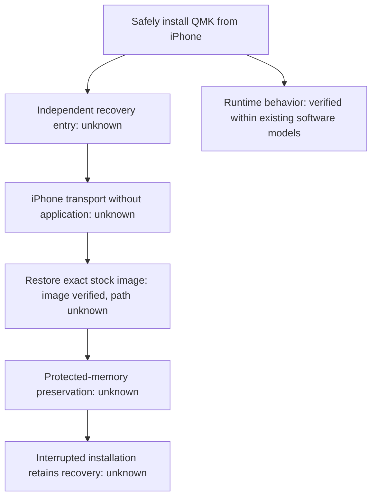

# Recovery research: existing mechanisms only, evidence-cited

Current decision: [independent iPhone recovery remains UNMET](adr/0001-independent-iphone-recovery.md), 2026-10-15.
Supporting evidence: [2026-10-14 recovery audit](recovery-audit-2026-10-14.md).
The investigation priorities below are historical, not authorization for device operations. See [current readiness](flash-readiness.md).

## Installation decision frontier, 2026-10-18

**The usable-keyboard objective remains unmet.** The completed software assurance
at [502ae25](https://github.com/rudironsoni/clicks-keyboards-custom-firmware/commit/502ae25ed68f107a5bc6b60c4d6b6ec33010bd46)
does not establish installation or recovery. This follow-up tests additional
evidence sources instead of repeating runtime hardening.



The decisive questions, in order, are:

1. Does the installed OEM bootstage expose a service before or without the
   application, and what selects it? A matching bootstage image or an applicable
   original recovery specification can answer this. Another application image
   cannot establish the missing service.
2. Can an iPhone communicate with that service? This requires its descriptors,
   protocol, and authentication behavior. A working stock ExternalAccessory
   session does not establish a bootstage session.
3. What does the installer erase, validate, copy, and commit after interruption?
   This requires the actual target implementation and device-region ownership,
   including the unknown tail. Host acknowledgments alone cannot answer it.

### The reviewed QMK image uses the unresolved tail interval

Static inspection of the exact reviewed BIN
`eef27f62706cbedc9fb61b485953a81cd76caccdafd6958853435846eed08df4`
shows 40 image bytes at file offsets `[0x48D8,0x4900)`, corresponding to
`[0x68D8,0x6900)`. ELF disassembly identifies executable instructions inside
`vendord_xfer_cb` throughout this interval. The 40-byte slice has SHA-256
`42a6d2cd2d1c96229ba46327a7b81bc7b3e32916652ff86917dbaf7558297873`.

This proves image occupancy, not a difference from the unknown device bytes.
There is no evidence that installing this fixed image and preserving the
original tail can both hold. Omitting those writes would not guarantee the
reviewed executable. Filling an image hole with `0xFF` also does not instruct an
unknown installer to skip a page. A new layout is premature until the tail's
ownership and installer write contract are established. The 256-byte erase
page `[0x6800,0x6900)` remains the interruption unit to assess, even for a shorter
image. See the [existing erase analysis](../../../research_notes/CK5200%20USB%20recovery%20feasibility/software-only-loader.md#5-pr6-valid-model-unsupported-physical-promise).

Verification used the pinned `riscv-none-elf-objdump` on `build/ck5200_qmk.elf`
with `-d --start-address=0x68c0 --stop-address=0x6920`, plus direct SHA-256 of the
BIN slice. No firmware bytes changed and no device read occurred.

### The iPhone manifest supplies a verified stock-image source

Both retained IPA packages identify Clicks 3.0.2, build 3. One native executable
declares `cryptid=0` and contains readable updater literals. Its SHA-256 is
`d56a59180adad89542107924edc1cc046507f6b11730f912f2855a8c408f5c6b`.
The other declares
`cryptid=1` and matches the extracted application executable. No Flutter
framework or named firmware-image resource was found in the package inventories.
The readable variant names `EAFService.loadFirmwares` and `downloadFirmware`,
but a complete updater call graph and its signature/provenance were not verified.
Instruction inspection follows the catalog selector at `0x1000E6E48` to the two
URL literals. The routine containing the `EAFService.loadFirmwares` log calls
that selector at `0x100180FA4`. Swift field metadata separately assigns the
`firmwareReboot`, `firmwareStart`, and related command cases to
`Clicks.PKService.Command` and `RequestContext`. That owner stores
`CBCentralManager` and `CBUUID` fields. Those names therefore do not establish
a CK-5200 USB bootloader command. The complete app call graph remains unverified.
Its declared ExternalAccessory protocols do not establish which protocols an
independent keyboard bootstage exposes. The public downloads below independently
corroborate the manifest literals and the retained stock hashes.

The bounded transport trace establishes an actual stream-writing path.
`SessionHandler` stores an `EASession?`; helper `0x1001CBD64` initializes it
with an existing accessory and protocol, then opens streams. Functions
`0x100178698` and `0x1001797D0` access its output stream and select closure
`0x100181488`. That closure calls `0x10017ECCC`, which calls writer
`0x1001CB86C`; instruction `0x1001CBA2C` invokes `write:maxLength:`.
This is executable host transport code, not a string-only inference.
The exact update-packet construction and CK-5200 model selection were not
resolved by this bounded trace. No separate recovery service was identified;
this does not prove that none exists. A host stream does not establish that
the keyboard exposes it when its application cannot start.

Building host software does not require the vendor app to support recovery.
The project already implements stream writes in
[`StreamLink.swift`](../../../ios/ClicksInspector/Sources/StreamLink.swift#L63-L79),
ordered stock-image transfer and an uncertain-outcome journal in
[`CustomFirmwareController.flash`](../../../ios/ClicksInspector/Sources/CustomFirmwareController.swift#L488-L650),
and exact-image and acknowledgment checks in
[`StockFirmwareTransaction.swift`](../../../ios/ClicksInspector/Sources/StockFirmwareTransaction.swift#L4-L82).
These are software implementations, not demonstrated safe installation.
All iOS builds still reject physical writes. The new native trace identifies
no additional host primitive that would establish independent recovery.
A new client can be built once an applicable target recovery protocol is
established. Replacing the existing writer or enabling QMK writes now would
leave the absent-application and preservation requirements unresolved.

Static inspection of that retained native executable found the exact
public URLs `https://xinyi1.clicks.tech/firmwares.json` and
`https://xinyi1.clicks.tech/firmwares-p.json`. Initial default-client requests
returned HTTP 403. Requests with `Accept: application/json` and
`User-Agent: Mozilla/5.0` returned HTTP 200 without credentials or an account.
The earlier blocked-download observation is superseded for these requests.

The main manifest is 12,006 bytes, SHA-256
`e1b84cad26d872c8560a221518c28e3d162d4daa6bf92f801722a4a0fa133633`.
It lists 52 releases with `model`, `firmwareRevision`, `file`, and `sha256sum`.
Six entries match `CK-5200` exactly. `CK-5200B` is a distinct manifest model and
was not substituted. The 827-byte `firmwares-p.json`, SHA-256
`6f274fbcd315bdadee59fce6f4eae407ac8ef1619429618f031fb19b872a3bd0`,
contains four `CP-1000` entries and no CK-5200 release.

All six exact CK-5200 release URLs returned HTTP 200. Each downloaded BIN
matches its advertised SHA-256. V121 and V122 also match the retained originals.
The initial jump and sampled vectors match an application linked at `0x2000`.
The reset jump lands inside each image. These are application-layout artifacts,
not identified whole-flash dumps or separately distributed OEM bootstages.

| Release | Bytes | Application extent from `0x2000` | SHA-256 |
| --- | ---: | --- | --- |
| 1.2.2 | 18,648 | `[0x2000,0x68D8)` | `8ee86935f5fbd622972fa55033f29fa551ba572288123046e21d79006f3b22f8` |
| 1.2.1 | 18,572 | `[0x2000,0x688C)` | `1c9ae5b2a4a838a5c62db0ce38c6d1d71c91fcc4101f0f8e37b365a746dac4aa` |
| 1.1.7 | 18,296 | `[0x2000,0x6778)` | `0ee35d494a6edf96183a5f4cb41e61230af9b1324da66b737bc5cc7cb5b3a58b` |
| 1.1.6 | 17,460 | `[0x2000,0x6434)` | `73a8f71683aadbdd74ef157d2662f6cd1c33ceb09dadca04c6a426f1d26e3e95` |
| 1.1.5 | 17,452 | `[0x2000,0x642C)` | `336f5658631bd5a9db1aba7481534574e0725e3c583bbd08b2263a8b4e85964e` |
| 1.1.4 | 16,828 | `[0x2000,0x61BC)` | `23327377867f8c3e14168d5af25e18ef4cea697d7d0b203cf970da06d5f6ac8f` |

This resolves current retrieval and provenance matching for the stock
application. It does not supply the contents of `[0,0x2000)` or
`[0x68D8,0x6900)`, or prove that an installer can restore V122 safely.
No release filename in either manifest identifies a bootloader or recovery
payload. That naming observation does not exclude an undocumented service or
embedded code. Only hashes and public URLs are recorded here. Downloaded
proprietary BINs remain private and are not committed.

The exact public catalog can be read without a device:

```sh
curl --fail --user-agent 'Mozilla/5.0' -H 'Accept: application/json' https://xinyi1.clicks.tech/firmwares.json
```

The checked V122 URL is
[the official application image](https://xinyi1.clicks.tech/CK-5200/iKeyboard_CK-5200_V122_120.bin).
Its availability is not authorization to install it.

### Additional public mechanisms checked

| Hypothesis | Evidence and result | Classification |
| --- | --- | --- |
| A newer Apple USB framework enables direct iPhone ISP | Apple's [Accessory Access](https://developer.apple.com/documentation/accessoryaccess) and [AAUSBAccessory](https://developer.apple.com/documentation/accessoryaccess/aausbaccessory) documentation JSON lists only macOS 27. [AccessorySetupKit](https://developer.apple.com/documentation/accessorysetupkit) describes Bluetooth and Wi-Fi discovery. [USBDriverKit](https://developer.apple.com/documentation/usbdriverkit) still names macOS and M-series iPads. | These checked public APIs do not supply the required iPhone raw-USB transport. This is not a proof about every privileged Apple implementation. |
| A newer maintained flasher supplies preservation-safe X035 restoration | [CHISP-Flasher X035 backend](https://github.com/jarczakpawel/CHISP-Flasher/blob/7e06f97f557819add9987b1e8fffc5d147dc5475/src/chisp_flasher/backends/ch32x03x.py) uses [native USB flashing](https://github.com/jarczakpawel/CHISP-Flasher/blob/7e06f97f557819add9987b1e8fffc5d147dc5475/src/chisp_flasher/backends/usb_native_family.py#L362-L475). The flow writes configuration fields, issues count-based erase, and programs from address zero. | Rejected as a CK-5200 preservation solution. Source inspected only; no flasher executed. |
| A newer public loader collection contains matching factory code | The [wch-protocols tree](https://github.com/ch32-riscv-ug/wch-protocols/tree/717e17a8d0bbe5390bd30e59f5a8ffd251a16e48) includes V003 factory dumps, X035 debug experiments, and replacement-loader references. Its [factory-ISP description](https://github.com/ch32-riscv-ug/wch-protocols/blob/717e17a8d0bbe5390bd30e59f5a8ffd251a16e48/protocols/pc-to-device-isp.ja.md) distinguishes target families and says its factory USB protocol account lacks its own capture. | No matching CK-5200 OEM or X035 factory image was identified in this bounded tree inspection. V003 code cannot establish X035 behavior. |
| Public product records disclose an independent service | The [CK-5200 certification listing](https://device.report/mfi/381981) supplies model metadata, not boot code or a recovery specification. Clicks' [app article](https://discover.clicks.tech/clicks-keyboard-app-v12-introduces-cursor-mode-clicks-key-customization-and-more) describes firmware download through the ordinary app with the phone inserted. | Normal update documentation, not dead-application recovery proof. |
| Archived exact distribution URLs supply missing artifacts | After restricted fetch failures, a network-enabled request to the Wayback availability API succeeded. Queries for the known V122 image, `firmwares.json`, and `firmwares-p.json`, using both HTTP and HTTPS source URLs, each returned HTTP 200 with an empty `archived_snapshots` object. | No snapshot was returned for those exact URLs. This does not search every archive or alternate URL. |

The official [firmware tutorial](https://youtu.be/ZN6Y_N3BZ3Q) yielded its title,
but its content and captions could not be retrieved. It is an unverified source,
not evidence for or against independent recovery.

### Candidate selection requires an installed recovery mechanism

| Candidate | Required missing capability | Decision under this goal |
| --- | --- | --- |
| Existing OEM boot service | Application-independent entry, an iPhone-accessible session, exact restore and restart semantics. | Most direct candidate, technically possible but unverified. No applicable implementation is available yet. |
| Installed factory ISP | WCH documents PC17 high at power-up as a family-level BOOT entry. CK-5200 connector routing, installed loader identity, an iPhone transport, and preservation-safe erase/program behavior remain unverified. | A concrete but unverified candidate. [Pinned entry evidence](../../../research_notes/CK5200%20USB%20recovery%20feasibility/boot-entry.md) does not establish the required device and host links. |
| A new first-stage loader or dual-image selector | Safe initial installation, durable entry outside the failed application, preserved OEM data, and a usable iPhone protocol. | Cannot be bootstrapped safely from the current evidence. Installing it to discover recovery would be circular. |
| Existing application rescue or stock update endpoint | The application and its transport must still execute. | Does not satisfy the required absent/corrupted-application cases. |
| Standard DFU, HID, or mass-storage recovery | An already installed independent loader implementing that protocol, plus a supported iPhone path. | A host app cannot add the missing target service. Replacement-loader source is not evidence it is installed. |
| An external USB host or programmer | Another host or added hardware. | Rejected by the iPhone-only and no-additional-hardware requirements. |

No candidate presently supports implementation of a safe installation sequence.
No replacement loader, speculative installer, or new image partition was added.

### Evidence that would change the decision

The next useful input is a provenance-backed CK-5200 bootstage image or an
applicable OEM recovery specification. It must establish the reset-to-recovery
path, iPhone-visible protocol, image acceptance rules, destination write set,
marker interpretation, and restart behavior after interrupted installation.
The original tail contents or an authoritative classification of those bytes
is also required. A matching factory-loader image could improve factory-ISP
analysis, but would not alone establish the CK-5200 entry wiring or iPhone path.

An existing lawful artifact or public release can be analyzed within the current
authorization. Vendor contact, a new device capture, physical readback, and an
experimental boot or write are prohibited here. Even complete static OEM code
would leave actual-device entry and interruption behavior subject to separately
authorized validation.

**UNRESOLVED FEASIBILITY BOUNDARY:** the checked public artifacts and native
transport trace provide stock images and an ordinary accessory writer, but
no established application-independent CK-5200 service or OEM installation
contract. The bounded trace is not a complete analysis of every app function.
No specific additional recovery route was identified that can be implemented
from the evidence in hand. A matching bootstage or recovery specification is
the next decisive input. The usable-keyboard objective remains unmet.


## Current D/E assessment, 2026-10-18

The active R3 requirement is recovery from a failed keyboard application using
the iPhone alone, with no additional hardware. The prior BLE-controlled USB host
adapter is outside this requirement. R3 remains **UNMET** and custom flashing
remains **NO-GO** under [flash-readiness.md](flash-readiness.md#L10-L12).

| Evidence class | Installer and memory finding | Checked source |
| --- | --- | --- |
| Actual device | The accepted iPhone sessions observed working stock getters, typing, and session reopening. They did not test an unbootable application or installer recovery. | [Readiness baseline](flash-readiness.md#L67-L75), [physical observations](flash-readiness.md#L77-L82) |
| Original artifact | The retained V122 file is 18,648 bytes and maps to `[0x2000,0x68D8)`. It contains no original bytes in presumed OEM bootstage `[0,0x2000)`. OEM marker validation, copy order, rollback, and boot handoff are unknown. | [Recovery audit](recovery-audit-2026-10-14.md#L18-L31), [ADR](adr/0001-independent-iphone-recovery.md#L13-L24) |
| Source code | The custom application stages updates at `0x08008A00`, with a four-byte length marker followed by payload. Its guard permits 256-byte page writes only in `[0x08008A00,0x0800F500)`. A1 invalidates the marker, A2 writes ordered chunks, and stock-only A3 hashes staged V122 before committing the length. | [Staging writer](../firmware/platform/ch32x035/ck5200_staging.c#L5-L36), [guard](../firmware/platform/ch32x035/ck5200_staging.c#L105-L149), [transaction](../firmware/platform/ch32x035/ck5200_staging.c#L190-L305) |
| Modeled | The host harness injects A1 and A3 page faults and A2 first, middle, and last page faults in four phases. It resets volatile state but keeps simulated flash. It calls the custom application updater again after a fault; it does not execute the OEM installer. | [Restore harness](../tests/ck5200_restore_test.c#L63-L98), [cycle](../tests/ck5200_restore_test.c#L125-L199), [A2 cases](../tests/ck5200_restore_test.c#L201-L263) |
| [INFERENCE] | Since both observed update dispatchers run in application callbacks, those paths cannot serve a keyboard whose application does not execute. This does not rule out an unseen OEM service. | [Recovery audit](recovery-audit-2026-10-14.md#L33-L47) |
| Unknown | V122 ends 40 bytes before the final 256-byte page boundary. `[0x68D8,0x6900)` has no original image bytes. Ordinary whole-page erase changes that tail, and no selective operation that preserves it through interruption is established. | [Region map](../../../reports/CK5200%20USB%20recovery%20feasibility.md#L198-L205), [counterexample](../recovery_lab/test_lab.py#L139-L147) |

The custom writer's erased-marker interpretation is a design assumption about
the unread OEM installer, not observed OEM behavior. The staged length and an
A3 acknowledgment do not prove that the installer accepts, copies, or retains
the image. [Staging comments](../firmware/platform/ch32x035/ck5200_staging.c#L17-L24),
[recovery audit](recovery-audit-2026-10-14.md#L33-L58).

| Application failure state | Current evidence | R3 result |
| --- | --- | --- |
| Application remains callable, transfer or staging write fails | The host harness models a fresh A1/A2/A3 attempt over retained flash, conditional on the custom update handler remaining callable. A2 first, middle, and last page faults leave excluded bytes unchanged in this model. [Restore harness](../tests/ck5200_restore_test.c#L125-L199), [A2 cases](../tests/ck5200_restore_test.c#L201-L263). | Modeled application retry only. Independent recovery unverified. |
| Application starts but update service or USB session fails | Stock and custom dispatchers reside in application callbacks. The iPhone updater requires an accessory session. [Recovery audit](recovery-audit-2026-10-14.md#L33-L43). | No demonstrated iPhone recovery channel. |
| Application entry is invalid, early startup fails, or application pages are erased | Neither retained image includes the OEM bootstage. Independent entry, its USB/iPhone service, and its behavior with invalid application code remain unknown. [ADR](adr/0001-independent-iphone-recovery.md#L13-L22). | No demonstrated recovery channel. |
| Install marker or other boot metadata is invalid | The custom staging harness rejects an A3 size mismatch and leaves its marker zero. The direct-entry CPU model adds no OEM bootloader or `0xF700` metadata. How the original bootstage interprets invalid metadata is unknown. [Restore harness](../tests/ck5200_restore_test.c#L492-L503), [CPU fixture](../assurance/runner.c#L440-L449), [ADR](adr/0001-independent-iphone-recovery.md#L19-L21). | Modeled custom rejection only. OEM recovery unverified. |
| Application repeatedly resets | The application reset handler arms its watchdog before startup loops. The CPU runner includes a repeated initialization reset-loop case with two modeled watchdog resets. It enters the application directly, so it does not establish an independent OEM service or an iPhone recovery path. [Reset handler](../firmware/platform/ch32x035/platform.c#L15-L80), [modeled case](../assurance/runner.c#L352-L360), [reset checks](../assurance/runner.c#L404-L411). | Modeled resets only. Independent recovery unverified. |
| Power fails while the OEM installer copies staged bytes | The host harness does not execute installer copy or restart. OEM marker checks, copy effects, and retry state are unknown. [Recovery audit](recovery-audit-2026-10-14.md#L49-L58), [ADR](adr/0001-independent-iphone-recovery.md#L19-L21). | Interruption safety unverified. |
| Presumed bootstage is lost | The inspected artifacts contain no original bytes below `0x2000`. [Recovery audit](recovery-audit-2026-10-14.md#L27-L31). | No verified restore source or independent service. |

The D host harness now covers A2 page-write faults, marker state, excluded
flash, and retry while the custom application update handler remains callable.
Further installer modeling needs the original bootstage or a model-matched OEM
contract; these tests cannot settle OEM installation. E needs a model-matched
OEM boot and iPhone transport contract, exact erase/program effects including
the unknown tail, and restart behavior before an executable recovery claim is
possible. The offline lab makes independent entry and a tail-preserving erase
explicit assumptions; its journal exists only in memory.
[A2 path](../firmware/platform/ch32x035/ck5200_staging.c#L212-L250),
[lab gates](../recovery_lab/lab.py#L113-L178),
[lab restart](../recovery_lab/lab.py#L275-L287),
[ADR](adr/0001-independent-iphone-recovery.md#L78-L83).

Status: 2026-10-12. This report answers one question: can a broken custom
application on the CK-5200 be recovered WITHOUT that application executing,
under the constraints of no new hardware, no dev board, no PCB modification,
and no invented replacement bootloader. The governing requirement comes from
the flash-safety reviews: a working stock-to-stock update never satisfies it.

Sources are classified: VERIFIED (read from source or datasheet), REPORTED
(third-party users), INFERENCE (labeled), or UNKNOWN. Memory-map and pin
claims cite a chapter, an SDK/BSP source line, or a stock-image address,
nothing else.

## 1. The MCU-family facts (VERIFIED)

| Fact | Evidence |
| --- | --- |
| Main flash is 248 pages x 256 bytes, ending `0x0800F7FF` | CH32X035 reference manual ch. 20 (per the 2026-10-12 review); both wchisp and chprog device tables list CH32X035 `code_size: 63488` |
| `0x0800F800..0x0800FFFF` is RESERVED | Reference-manual memory map; the pinned TinyUSB BSP linker models `__flash_size : 62K` |
| Factory USB ISP exists on the family | wchisp README "Tested On" lists CH32X035; chprog DEVICES table lists seven CH32X035 variants |
| The ISP device is a plain USB vendor device | chprog source: VID `4348`/`1a86`, PID `55e0`, endpoints `0x02`/`0x82`; no MFi, no iAP2 |
| PC17 is a BOOT-detection pin, sampled at power-on, and is also USB D+ | CH32X035 datasheet (per the 2026-10-12 review); corroborated by maxgerhardt/ch32x035-arduino-usb-serial (resistor PC17-VCC) and wagiminator/CH32X035-USB-PD-Adapter (BOOT button); a WCH evaluation board documents a Download button on PC17 |
| X035 debug is WCH SDI on PC18/PC19, not ARM SWD | TinyUSB BSP `wch-riscv.cfg`: `adapter driver wlinke`, `transport select sdi` |
| Removing read protection can erase the user area | WCH documentation; wchisp issue #68 documents a real CH32X035F8U6 flashing failure caused by read protection |

## 2. Host-tool capability matrix (VERIFIED from the fetched sources)

| Capability | wchisp | chprog |
| --- | --- | --- |
| Default flash flow | identify, inspect config, erase, program, verify, reset (the "unprotect -> ..." text is a source comment; the CLI flash command does not unprotect) | detect (may rewrite protection config when flags indicate a protected device: destructive), erase, write, verify, reboot |
| Write base | hardcoded `address = 0x0`, no offset option | hardcoded `offset = 0`, no offset option |
| Erase semantics | `erase_code(sectors)` from the start, minimum sector count enforced | `erase(len)` with a minimum of 8 KB even for a tiny image: exactly the Clicks installer region |
| Code-flash readback | NOT implemented: `verify` is device-side comparison only | NOT implemented: same verify-only design |
| Config/EEPROM read | config registers and data EEPROM dump: YES | config read: YES |
| CH32X035 support | YES (device DB + X035-specific register handling) | YES (seven X035 variants in the device table) |

Consequences for the CK-5200:

1. A plain `flash` with our application-only V122 image (linked at `0x2000`)
   would ERASE AND OVERWRITE the Clicks installer at `0x0..0x2000`. The
   inspected local artifacts contain no installer backup. [CORRECTION] The
   earlier claim that no copy exists anywhere was unsupported. No available
   restore source is established for a lost installer.
2. The hoped-for "enter ISP, dump the installer" is not implementable with
   these tools today: neither implements code-flash readback. This does not
   prove that SDI is the only possible evidence source.
3. Even an apparent identification run deserves transcript review: chprog's
   `detect()` can perform a protection-config write on some device states.

## 3. The five questions (current answer states)

| # | Question | State |
| --- | --- | --- |
| 1 | Factory bootloader accessible after the app fails, CK-5200, no PCB access? | UNKNOWN, one live lead: the PC17 BOOT entry is family-verified. Whether the CK-5200's PC17 (USB D+) can be asserted safely at power-on without board modification is unanswered, and the presence of USB D+ is not permission to drive it externally. Software entry (`SystemReset_StartMode(Start_Mode_BOOT)` in the X035 SDK) requires a running application and is NOT independent recovery. |
| 2 | Boot-entry mechanism without PCB modification? | UNKNOWN. Candidates: PC17 strap (board routing unknown), blank-flash auto-ISP (presupposes erasure), software flag (not independent). |
| 3 | Clicks installer fallback independent of app/HID/iAP2? | UNKNOWN. A dump, matching implementation, or vendor documentation could supply evidence. The demonstrated A1/A2/A3/A0 service lives in the application (stock `0x3216`). An independent service would need separate executable code. |
| 4 | Recovery channel reachable from the iPhone? | No documented public API route was found for an ordinary iPhone app to the stated factory ISP. Installer fallback remains unknown. USBDriverKit supports macOS and M-series iPads, not iPhone in the documented hardware support. See [the 2026-10-14 Apple source check](iphone-recovery-transport.md). |
| 5 | Restore official stock without touching installer/config/serial/auth? | UNKNOWN end to end. Inspected application staging paths have bounded writes. The unread installer's copy bounds and device-specific preservation are not proven. Default ISP tools erase/write from offset zero and are unsuitable. |

## 4. Recovery-channel matrix per failure scenario

| Failure scenario | Clicks update dialect (needs a working app) | Factory USB ISP | SDI probe |
| --- | --- | --- | --- |
| Stock running, staging interrupted | Host harness demonstrates fresh A1/A2/A3 rewriting simulated staging. Actual installation remains unverified. | Default tool writes threaten the installer. | UNVERIFIED on this board. Not iPhone-only. |
| Custom app runs, has a fault | Available only if the application's USB and update service still execute. No physical custom restore is proven. | Entry and preservation remain UNKNOWN. | UNVERIFIED on this board. Not iPhone-only. |
| Custom app does not boot | NO | Board entry UNKNOWN. No supported public iPhone transport found. | Pad continuity, protection, and restoration remain UNVERIFIED. Not iPhone-only. |
| USB does not enumerate | NO | Board entry UNKNOWN. No supported public iPhone transport found. | Same unverified conditions. Not iPhone-only. |
| Presumed installer region destroyed | No demonstrated route. No inspected backup. | Does not supply the missing proprietary bytes. | A matching restore source and verified access would be necessary. Neither is established. |

## 5. Non-eliminable risks under the current constraints

- First live boot of the re-targeted CH32X035 firmware happens on the only
  keyboard (the dev-board rehearsal was consciously removed, 2026-10-12).
- The installer is unread until a dump route exists; every "what does the
  boot region do?" claim is about unread code.
- [CORRECTION] The earlier "recovery is Mac-only" conclusion was too broad.
  No independent CK-5200 recovery is demonstrated on any host. Apple's public
  USB driver support includes M-series iPads, but not a documented iPhone route.
- 100 percent reliability is not claimable through software tests alone. The
  demand is explicit failure coverage, independently verified implementation,
  and demonstrated behavior under interrupted or corrupted updates.

## 6. GO/NO-GO recommendation

**NO-GO for any flash of the CK-5200 at this time** (2026-10-12), for stock
re-flash and custom alike. The single condition that would change this: a
demonstrated, independently accessible recovery path. The highest-value
investigation, in order:

1. PC17 BOOT entry on the CK-5200: board routing, safe assertion at
   power-on, the case's power sequencing. A proposed live entry experiment
   requires your separate approval; no electrical manipulation happens on
   datasheet inference alone.
2. If PC17 is accessible: a read-only protocol transcript (wchisp-style
   identify/config-read only, no erase, no program, no config write) would
   establish chip identity and protection state without destruction. Code
   flash still cannot be dumped with these ISP tools, so this does NOT produce the
   installer backup.
3. If PC17 is not accessible: report the recovery requirement as UNMET. The
   SDI probe route was the historical full-dump lead and requires
   physical access decisions outside the current constraints. Photo
   update: labeled 3V3/SWD/GND/SWC pads beside U3 make this route
   concrete; continuity, pin assignment, and protection state remain
   unverified (hardware-photo-report.md).

A successful stock-to-stock update must never be used to override this
conclusion.

## 7. Photo evidence update (2026-10-13)

The 24 back-side PCB photographs are analyzed in
[hardware-photo-report.md](hardware-photo-report.md). Effects on this
report: U3 is a 48-lead QFP (12 leads per side, VERIFIED in five frames by
two models), so the CH32X035C8T6 (LQFP48) replaces the R8T6 (LQFP64M) as
the package hypothesis and that report's pin table applies (PC16=32,
PC17=33, PC18=34, PC19=37). Four labeled pads 3V3/SWD/GND/SWC sit beside
U3 (labels VERIFIED, two models; continuity UNVERIFIED). No BOOT pad
appears in any photo, so the PC17 questions stay UNKNOWN. The GO/NO-GO is
unchanged.

The SDI route is now concretized in
[recovery-sdi-probe.md](recovery-sdi-probe.md): the read-only tooling
(`wlink` supports CH32X035 identify, protection-state read, and a full
flash dump), the WCH-LinkE probe requirement, the unpowered continuity
procedure that must precede any probe session, and the hard prohibitions
(no erase, no write, no unprotect, no chprog). Nothing in it has been
executed.
